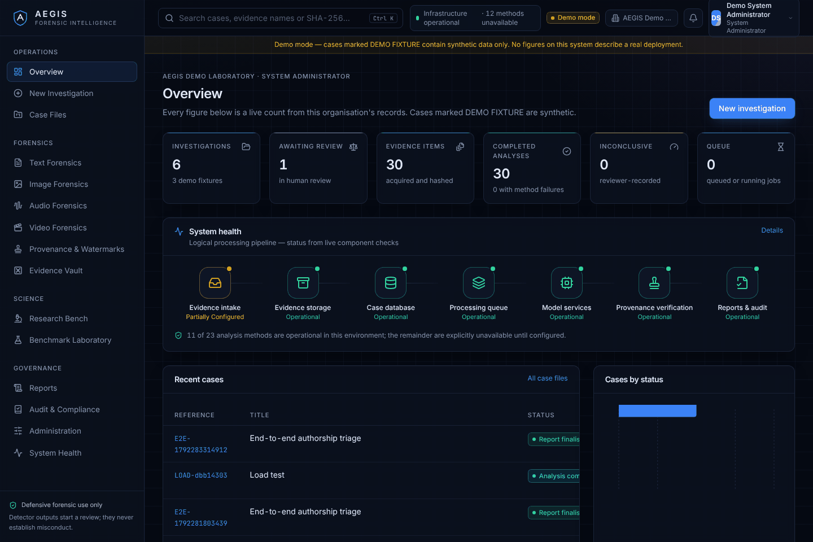
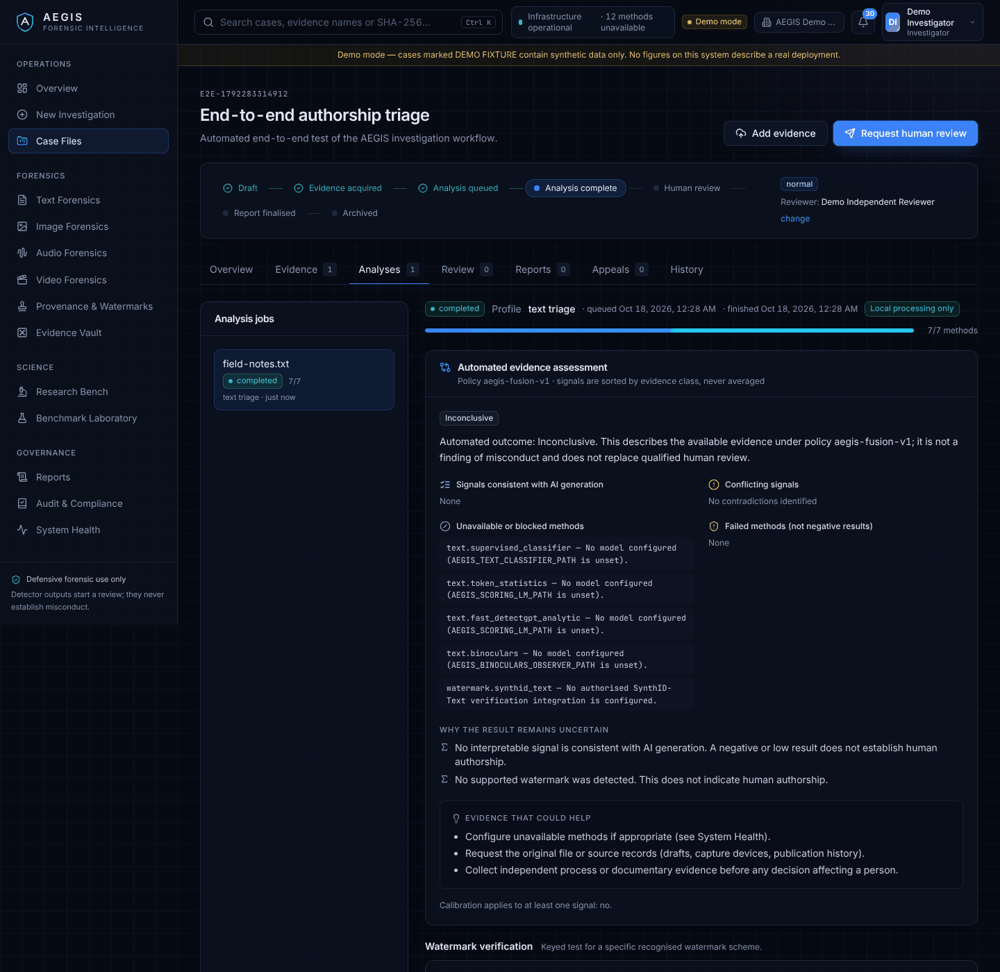
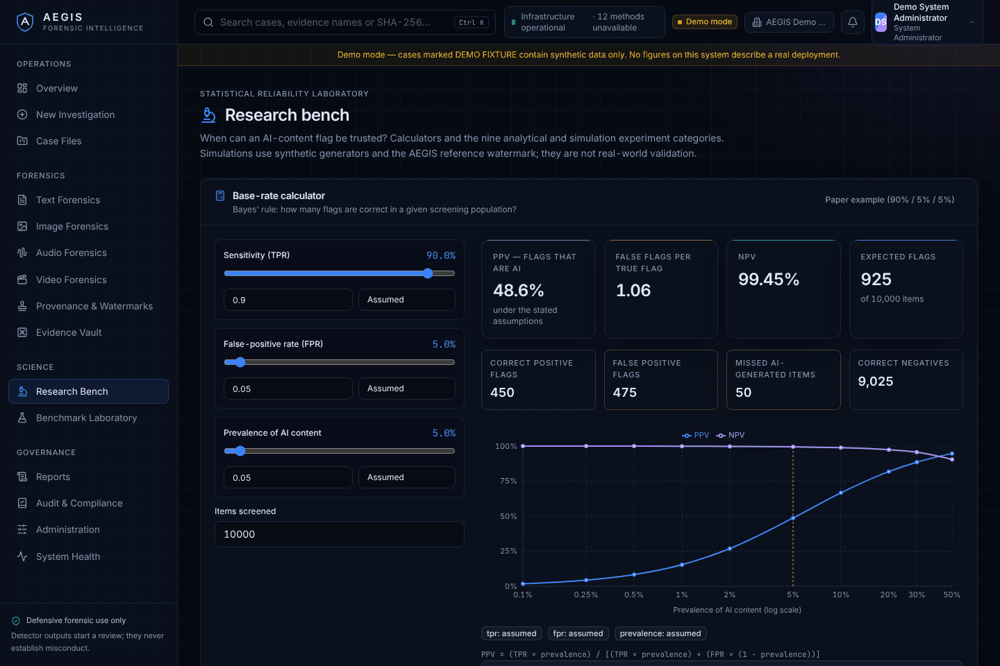
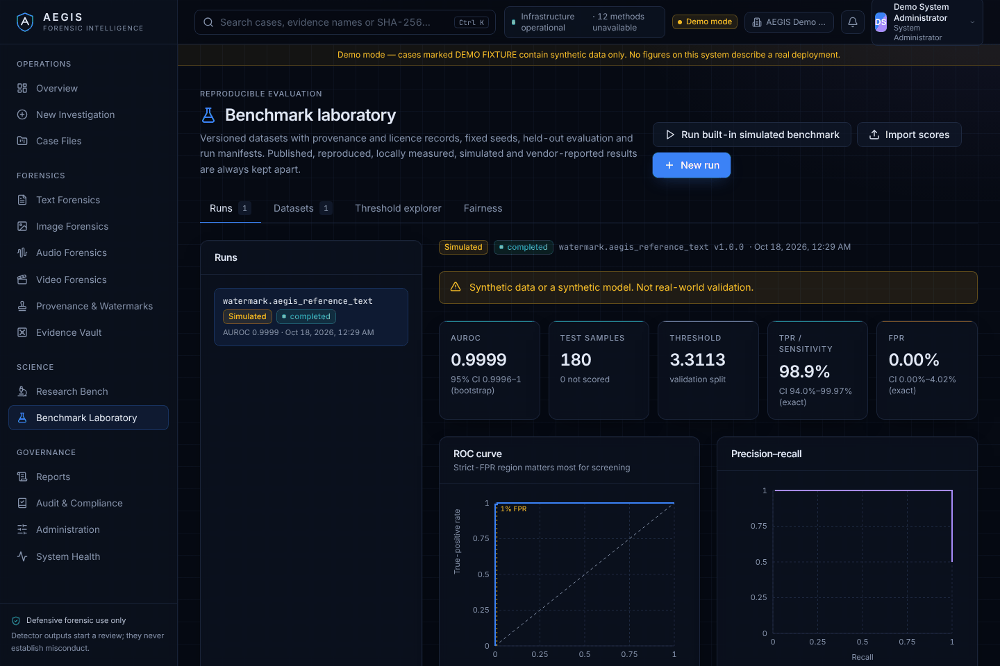
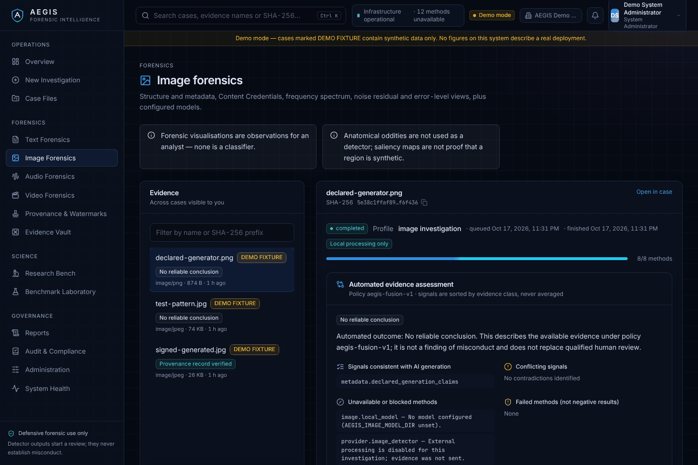
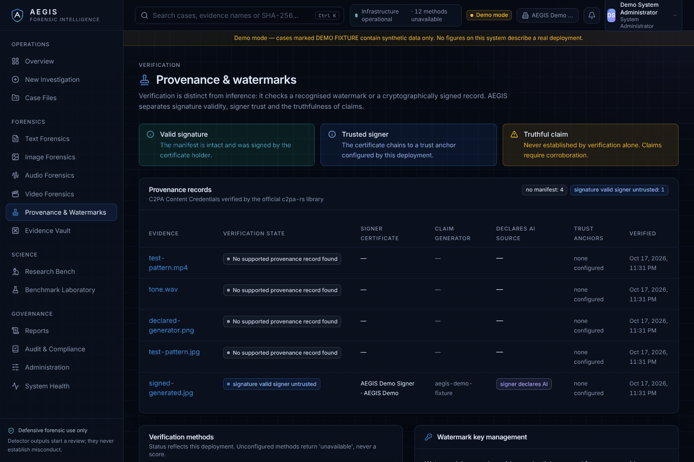
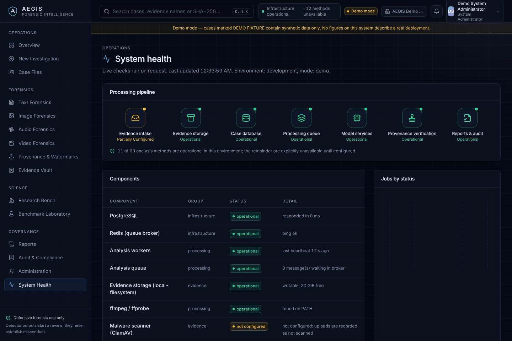

<div align="center">


# AEGIS

**Advanced Evidence, Generation Intelligence & Synthetic-Media Forensics System**

A multimodal forensic platform that helps authorised analysts examine whether digital content may have been generated or materially altered by AI. It never claims more certainty than the evidence supports.


</div>

<p align="center"></p>

## What AEGIS does

AEGIS treats these as **different kinds of evidence**, and never mixes them up or averages them together:

| Evidence class | What it is | Example in AEGIS |
| --- | --- | --- |
| Statistical inference | How closely content resembles output from known AI generators. **Not proof of authorship.** | Supervised classifier, token statistics, Fast-DetectGPT, Binoculars (adapters that run once model weights are configured) |
| Watermark verification | A keyed test for one specific, recognised watermark scheme | AEGIS reference green-list watermark (Kirchenbauer et al., 2023) |
| Signed provenance | A cryptographic check of a signed record. A valid signature does not make the record's claims true. | C2PA Content Credentials, checked with the official `c2pa-rs` library |
| Forensic observation | Measurements and visualisations for an analyst; not a classifier | EXIF/ICC/JPEG tables, frequency spectrum, noise residual, ELA, spectrograms, video timelines |
| Declared metadata | Unsigned claims embedded in the file, which anyone can edit | PNG text chunks, EXIF Software, XMP DigitalSourceType |
| Process evidence | Drafts, revision history and notes | Evidence uploaded with the `process_evidence` role |
| Human assessment | The conclusion of a qualified reviewer | A review decision that is hashed and recorded in the audit trail |

The platform's principles:

- A flag from a detector **starts a review**. It never establishes misconduct.
- A low score does not prove human authorship.
- A missing watermark or provenance record proves nothing either way.
- A method that cannot run reports `unavailable`; it never invents a score.
- A method that fails is recorded as `failed`, never as a negative result.

## Screens

| | |
| --- | --- |
|  **Case workspace:** automated assessment, unavailable methods with reasons, results grouped by evidence class |  **Research bench:** Bayes positive-predictive-value (PPV) calculator with labelled input sources, and the nine reliability experiments |
|  **Benchmark laboratory:** simulated results labelled as such, exact confidence intervals, checks on whether a strict false-positive rate can be estimated |  **Image forensics:** provenance, metadata and forensic visualisations, each stating what it *cannot* establish |
|  **Provenance & watermarks:** signature validity, signer trust and the truth of claims kept apart |  **System health:** live component checks and the true status of each method |

## Quick start

**Option A: Docker Compose** (all services)

```bash
cp .env.example .env            # then set AEGIS_SECRET_KEY to a long random value
docker compose up --build -d    # postgres, redis, migrate, api, worker, beat, web
docker compose exec api python -m app.cli seed-demo   # development only: demo users + DEMO FIXTURE cases
open http://localhost:3000      # sign in as investigator@aegis.demo / Aegis-Demo-Only-2026
```

**Option B: local development** (needs Python 3.11+, [uv](https://docs.astral.sh/uv/), Node 22, pnpm 10, PostgreSQL 16, Redis 7 and ffmpeg)

```bash
make setup        # uv sync --frozen, pnpm install --frozen-lockfile, creates .env
make services     # PostgreSQL + Redis in Docker (or use locally installed ones)
make migrate      # alembic upgrade head + roles/model-registry sync
make seed-demo    # demo organisation, one user per role, three DEMO FIXTURE cases
make dev          # API :8000 (docs at /api/docs), Celery worker, web :3000
```

Demo accounts (development only; seeding is refused when `AEGIS_ENVIRONMENT=production`):
`admin@`, `orgadmin@`, `investigator@`, `analyst@`, `reviewer@`, `auditor@`, `researcher@aegis.demo`. The password is the value of `AEGIS_DEMO_PASSWORD` (default `Aegis-Demo-Only-2026`).

<details>
<summary><b>All make targets</b></summary>

| Target | Purpose |
| --- | --- |
| `make setup` | Install locked Python and Node dependencies; create `.env` |
| `make services` | Start PostgreSQL and Redis containers |
| `make migrate` | Apply migrations, synchronise roles and the model registry |
| `make seed-demo` | Load clearly labelled demo fixtures |
| `make dev` / `api` / `worker` / `web` | Run the stack or one component |
| `make test` | Python (research, ML, API integration on PostgreSQL) + web unit tests and type check |
| `make test-e2e` | Playwright browser tests against a running, seeded stack |
| `make lint` / `format` | Ruff and ESLint |
| `make benchmark` | Built-in simulated benchmark and the nine experiments → `benchmarks/runs/` |
| `make experiments` | Experiments only, with PNG plots → `research/results/` |
| `make loadtest` | Repeatable API load test |
| `make verify` | Recompute every stored evidence hash and verify the audit chain |
| `make security-check` | pip-audit, pnpm audit, CycloneDX SBOM |
| `make build` / `up` / `down` | Container images and the Compose stack |

</details>

## Repository layout

```
apps/
  api/          FastAPI service, SQLAlchemy models, Alembic migrations, Celery workers, CLI, tests
  web/          Next.js 15 workstation (App Router, Tailwind, TanStack Query/Table, Recharts), Playwright tests
  worker/       Worker entrypoint notes (the worker runs the API image with a Celery command)
ml/             aegis_ml: analysis methods, content sniffing, C2PA verifier, provider adapters, evidence fusion
research/       aegis_research: reliability statistics, reference watermark, the nine experiments
packages/       shared-types: TypeScript API contract shared by clients
infrastructure/ Dockerfiles
docs/           architecture, security, API, research, operations and governance documentation
scripts/        dev runner and load test
benchmarks/     run outputs (git-ignored)
```

## What is genuinely operational

| Capability | Status in this build |
| --- | --- |
| Case management, state machine, separation of duties, appeals, corrections | Operational, tested |
| Evidence vault: content sniffing, SHA-256, write-once storage (local / S3), versions, redaction, integrity alerts, two-person deletion | Operational, tested (S3 tested against moto) |
| Text extraction (TXT, PDF, DOCX), segmentation, language ID (incl. Hindi/Indic scripts) | Operational, tested |
| C2PA Content Credentials verification | Operational, tested with signed, tampered and unsigned files |
| AEGIS reference text watermark verifier | Operational, tested. Verifies only text from the AEGIS reference generator under this deployment's key |
| Image / audio / video forensic observations | Operational, tested (Pillow, NumPy/SciPy, ffmpeg) |
| Supervised, token-statistic, Fast-DetectGPT and Binoculars text detectors | **Adapters implemented, not operational:** no model weights are bundled, and the build environment could not download any |
| Synthetic-speech and image classifiers (ONNX), external provider services | **Integration boundaries:** run only once a model or authorised provider is configured |
| SynthID-Text and other provider watermarks | **Placeholder:** needs a provider agreement, keys and detector weights |
| Calibrated probabilities / validated operating thresholds | None in this build: no detector has been validated on locally measured real data |

See [docs/governance/limitations-and-residual-risks.md](docs/governance/limitations-and-residual-risks.md) for the full list.

## Documentation

- **Architecture:** [overview & diagrams](docs/architecture/overview.md) · [data model](docs/architecture/data-model.md) · [decisions](docs/architecture/decisions.md)
- **Security:** [threat model](docs/security/threat-model.md) · [controls matrix](docs/security/security-controls.md) · [audit chain](docs/security/audit-chain.md)
- **API:** [API guide](docs/api/README.md) · [provider contract](docs/api/provider-contract.md) · OpenAPI at `/api/docs`
- **Research:** [methods & literature map](docs/research/methods-and-literature.md) · [evaluation methodology](docs/research/evaluation-methodology.md) · [experiments & results](docs/research/experiments.md) · [model cards](docs/research/model-cards.md) · [dataset cards](docs/research/dataset-cards.md) · [multilingual plan](docs/research/multilingual-evaluation-plan.md) · [independent evaluation protocol](docs/research/independent-evaluation-protocol.md)
- **Operations:** [college server setup](docs/operations/college-server.md) · [deployment](docs/operations/deployment.md) · [configuring detectors](docs/operations/configuring-detectors.md) · [backup & recovery](docs/operations/backup-and-recovery.md) · [incident response](docs/operations/incident-response.md) · [performance](docs/operations/performance.md) · [troubleshooting](docs/operations/troubleshooting.md)
- **Governance:** [pilot readiness package](docs/governance/README.md) · [compliance mapping](docs/governance/compliance-mapping.json) · [human review & appeal procedure](docs/governance/human-review-and-appeal-procedure.md) · [roadmap](docs/governance/roadmap.md)

## Responsible use

AEGIS is defensive investigative software. It contains no surveillance, account-access or device-monitoring features, and it performs no biometric identification. It never infers a person's identity, nationality, ethnicity or intent. It holds no government approval or certification, and it claims none. Before any operational deployment, a legal, privacy and security review is required. A detector score alone must never lead to punishment, rejection, prosecution or any other adverse decision about a person.

## License

[MIT](LICENSE)
