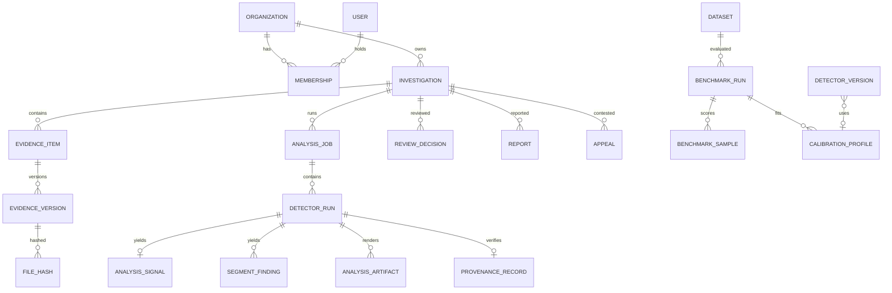

# Data model

Source of truth: `apps/api/app/models/__init__.py`. The schema is created only through Alembic (`apps/api/migrations`). All primary keys are UUIDs except `audit_events.seq`, a monotonic identity that orders the hash chain.

| Area | Tables | Notes |
| --- | --- | --- |
| Identity | `organizations`, `workspaces`, `users`, `roles`, `permissions`, `role_permissions`, `memberships`, `user_sessions` | Roles and permissions are seeded from `security/permissions.py` by `app.cli sync`. Sessions store only a SHA-256 of the refresh token. MFA secrets are Fernet-encrypted. |
| Cases | `investigations`, `annotations`, `review_decisions`, `appeals`, `deletion_requests` | `(organization_id, case_reference)` is unique. Review decisions carry a content hash and the hash of their audit event. |
| Evidence | `evidence_items`, `evidence_versions`, `file_hashes`, `upload_sessions` | `(evidence_item_id, version_no)` is unique. `file_hashes` records acquisition hashes and every integrity re-check (`matches_recorded`). Purged versions keep their hash as a tombstone. |
| Analysis | `analysis_jobs`, `detector_runs`, `analysis_signals`, `segment_findings`, `analysis_artifacts`, `provenance_records` | `(job_id, method_id)` is unique (idempotency). Each run records method id, version, configuration, threshold, input SHA-256, output schema and timestamps. |
| Registry | `model_providers`, `detector_versions`, `calibration_profiles` | `(method_id, version)` is unique. Validation requires a benchmark run reference (enforced in the API). |
| Research | `datasets`, `benchmark_suites`, `benchmark_runs`, `benchmark_samples`, `experiment_runs` | `benchmark_runs.result_kind` is restricted by a CHECK constraint to published / reproduced / locally_measured / simulated / vendor_reported. |
| Governance | `reports`, `audit_events`, `retention_policies`, `notifications`, `system_health_events`, `system_settings` | `(investigation_id, version)` is unique per report. `audit_events.event_hash` is unique; `prev_hash` links the chain. |
| Object store | `stored_objects`, `stored_object_chunks` | Used only with `AEGIS_STORAGE_BACKEND=database`. An object and its ordered chunks are inserted in one transaction and never updated; the key is the primary key, so a second write fails. |

Indexes cover tenant/status filters (`ix_investigations_org_status`), audit queries by organisation and time and by entity, unread notifications, and job status.

## Entity relationships (core)



## Migrations

```bash
cd apps/api
alembic upgrade head        # apply
alembic downgrade base      # roll back everything (development only)
alembic check               # fails if models and migrations diverge
alembic revision --autogenerate -m "describe change"
```

The API test harness drops the test schema and runs `alembic upgrade head` from empty on every test session. Migrations are therefore exercised from a clean database on every run.
