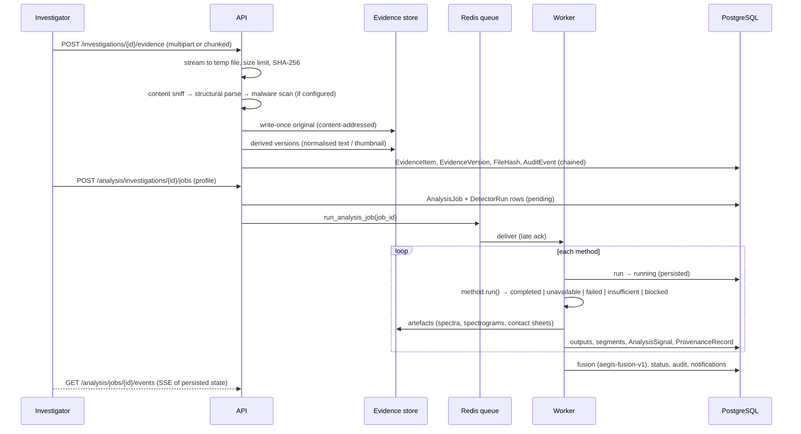
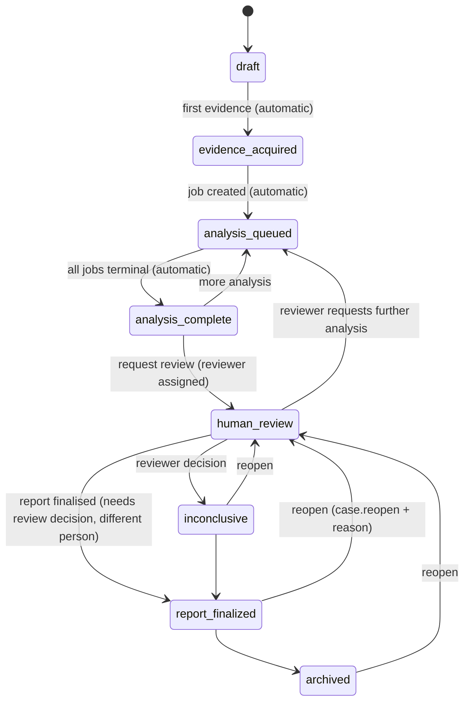

# Architecture overview

AEGIS is a modular monorepo with four layers, kept deliberately separate:

| Layer | Package | Responsibility |
| --- | --- | --- |
| Research | `research/aegis_research` | Pure statistics: Bayes PPV/NPV, exact intervals, ROC/PR, calibration, strict-FPR operating points, reference watermark, nine experiments. No I/O. |
| Analysis methods | `ml/aegis_ml` | Content sniffing, extraction, every forensic/detection/verification method, provider adapters, evidence fusion policy. No database. |
| Application | `apps/api/app` | Identity, RBAC, tenancy, cases, evidence vault, job orchestration, reports, audit, benchmarks, administration. |
| Presentation | `apps/web` | Investigative workstation; talks only to the versioned REST API. |

## Components

```mermaid
flowchart LR
  subgraph Browser
    W[Next.js workstation<br/>in-memory access token]
  end
  subgraph Edge
    RP[TLS reverse proxy<br/>(operator-provided)]
  end
  subgraph App["Application tier"]
    WEB[web :3000<br/>Next.js server, /api rewrite]
    API[api :8000<br/>FastAPI + SQLAlchemy]
    WK[worker ×N<br/>Celery]
    BT[beat<br/>stale-job recovery]
  end
  subgraph Data["Data tier"]
    PG[(PostgreSQL 16<br/>cases, runs, audit chain)]
    RD[(Redis 7<br/>broker, rate limits, heartbeat)]
    OS[(Evidence store<br/>write-once local FS or S3)]
  end
  EXT[[Optional external detectors<br/>blocked by default]]
  W --> RP --> WEB --> API
  API --> PG
  API --> RD
  API --> OS
  RD --> WK
  WK --> PG
  WK --> OS
  BT --> RD
  WK -. only if deployment, org and case allow .-> EXT
```

## Evidence and analysis data flow



## Investigation state machine



Finalised and archived cases refuse edits and new evidence. Corrections create a new report version and preserve the previous one.

## Key design properties

- **No fabricated output.** `AnalysisMethod.run()` wraps every method. Unsupported input, a policy block, missing configuration or an exception each produce an explicit status. A score is only ever set by a method that actually computed it.
- **Idempotent, resumable jobs.** `DetectorRun` is unique per `(job_id, method_id)`. A redelivered task skips completed runs. `recover_stale` requeues jobs abandoned by a lost worker, at most three attempts.
- **Truthful progress.** Progress is `methods_done / methods_total` from the database. SSE emits only when persisted state changes; nothing is timer-driven.
- **Evidence classes never mix.** The fusion policy (`ml/aegis_ml/fusion.py`) never averages or multiplies scores. It reports agreeing, conflicting, missing and failed signals, and a contradiction state.
- **Separation of duties.** The case creator cannot review their own case. A report's author cannot finalise it. A deletion requester cannot approve their own request. An appellant cannot resolve their own appeal.
- **Defence in depth on tenancy.** Every query is scoped by organisation membership. Identifiers belonging to another tenant return 404, identical to "missing".
- **Reproducible reports.** The PDF is rendered from the canonical JSON payload in ReportLab invariant mode, so verification re-renders it and compares hashes.

## Scaling notes

The API is stateless; run multiple uvicorn workers or replicas behind the proxy. Workers scale horizontally. Model-backed methods should run in dedicated worker pools (separate queue) sized to model memory, with GPU nodes where available. PostgreSQL holds only structured data; binaries live in object storage. The exception is the `database` storage backend, for hosts without a persistent disk (see [Render](../operations/render.md)), which keeps write-once objects in PostgreSQL and suits small deployments only. See [performance](../operations/performance.md) for measured numbers and test conditions.
